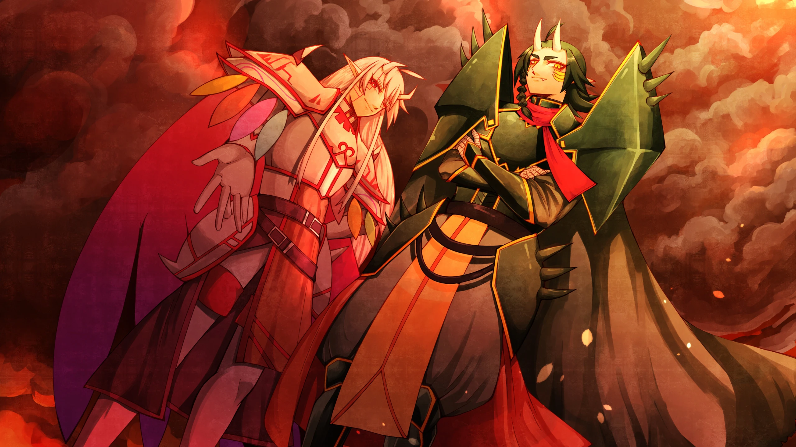
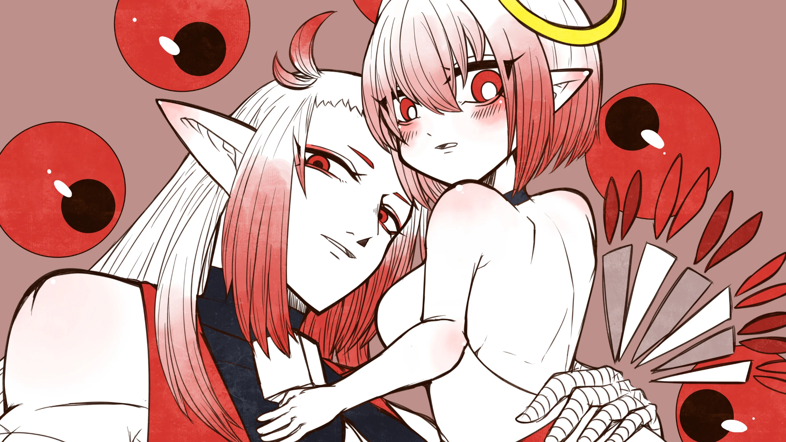

# Hilava

  

しがない絵描きです。たまに細々と開発しています。  

## About Me

### 🎨イラスト制作
デジタルイラスト歴14年程、全体的なイラスト歴は20年程です。歴だけはあるしがない絵描きです。  
二次創作イラスト中心に描いています。星のカービィ擬人化創作が熱いです。

### 🛠️開発
AstroやPubliiの個人向けイラストサイトテーマを開発・公開しています。絵描きさんが個人サイトを持つきっかけになれれば幸いです。

## 🚀 Featured Projects

  <!-- 1つ目のリポジトリ -->
  
  
    

## 📊 GitHub Stats

  

## 🎵 Now Playing

  

## 🔗 Links

